# DLIS Teacher Assistant

**One calm place for a teacher's whole week.** A desktop app (Windows and Mac) built for the teachers of Dar Luqman Al-Hakim International School: it knows your timetable and the school calendar, prepares the school's official Word files in one click, keeps your files, questions and notes in order, and uses AI **without ever sending a student's name to it**.

Arabic (right to left) and English. Everything is stored in a folder you choose, on your own computer.

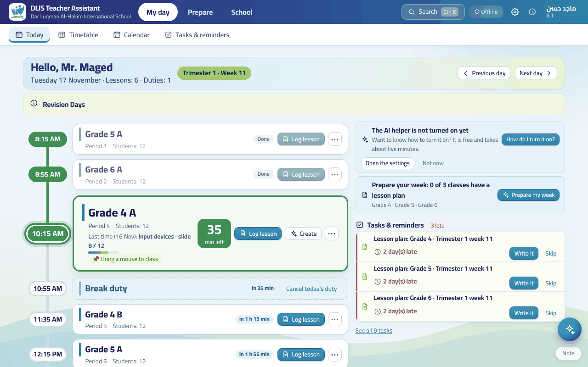

## What it does

### Your day
| | |
|---|---|
| **Today**: a timeline of your lessons and duties. The current lesson is big, the next ones are slim. It shows how far each class has got, last time's note, and starts a gentle alarm 10 minutes before a lesson (not when lessons are back to back). Cover a colleague, swap two lessons or cancel a duty for just one day. |  |
| **Timetable**: your weekly timetable in one screen with no scrolling. Lesson times, breaks, prayer and the end of the school day are the school's structure, and the school day can be edited. | 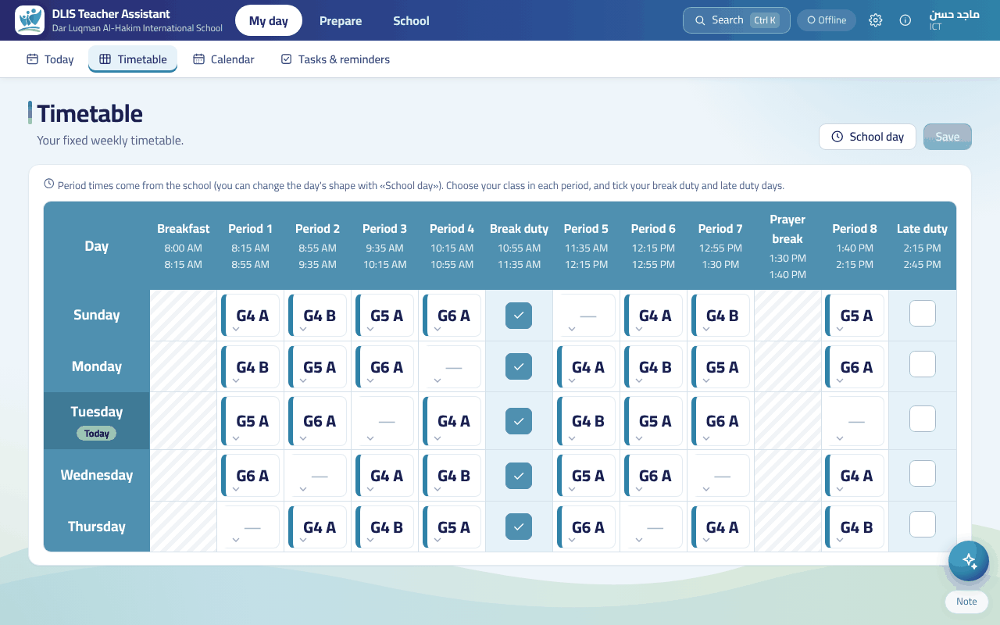 |
| **Calendar**: the official school calendar as a year picture (weeks line and month view). The current trimester and week are always marked. | 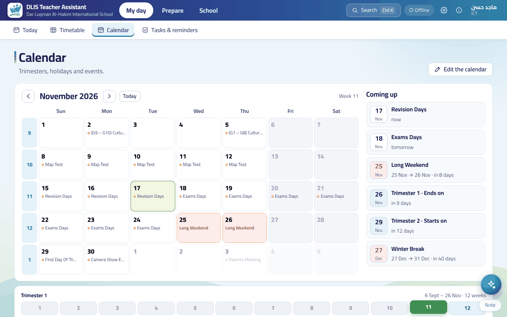 |
| **Tasks and reminders**: your own tasks with importance and a deadline, plus the lesson plans that are still missing, collected automatically. Reminders with snooze and skip, and they keep working after the window is closed. | 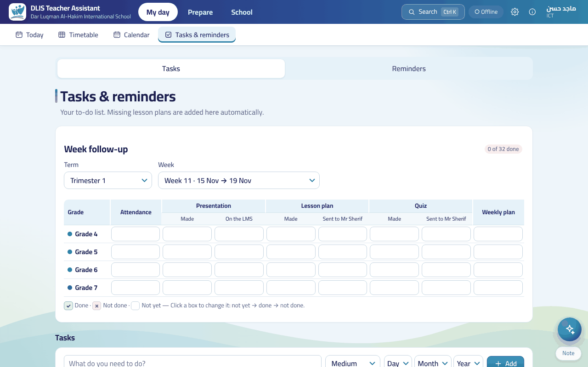 |

### Prepare
| | |
|---|---|
| **Create**: one page for everything you make. The official DLIS files (weekly lesson plan, short quiz, revision sheet, grading sheet, certificates and thank-you cards, lesson slides) are big tiles, next to 27 ready AI tools. You choose the class, term and week inside. | 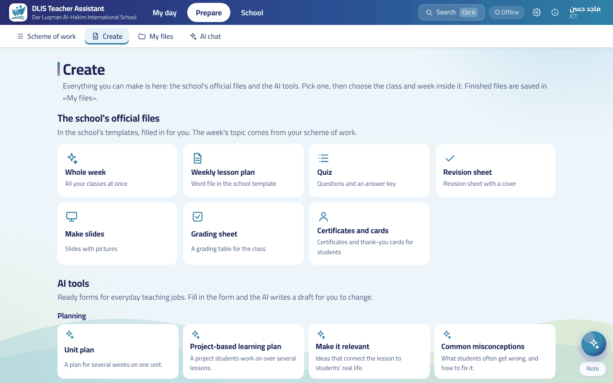 |
| **AI tools**: fill a short form (topic, level, how many) and get a draft you can edit: unit plans, rubrics, differentiated tasks, parent messages and more. The AI only reads **your** sources, and it never receives student names. | 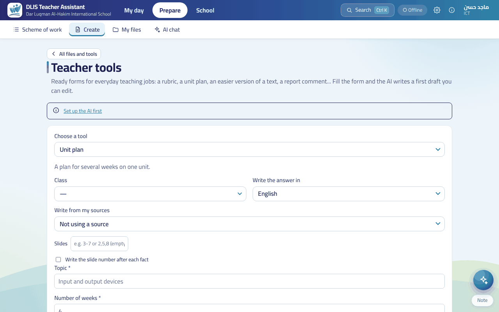 |
| **My files**: every file, link and message you made, kept by grade and week. One switch decides what students and parents can see. Every file you add is also available to the AI as a source. | 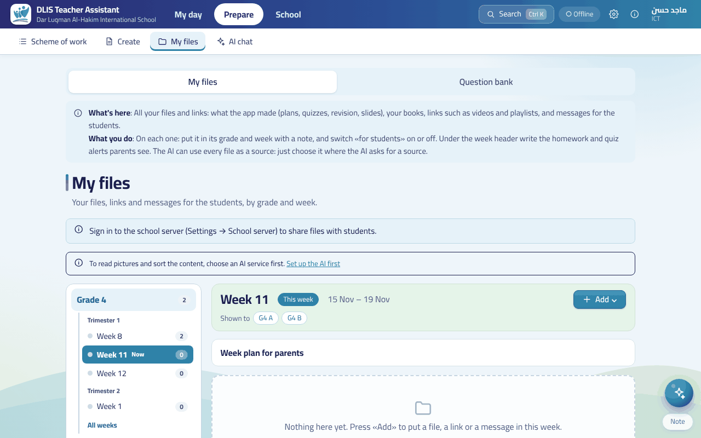 |
| **Question bank and exam builder**: topic cards show how many questions you have, how they split by level, and how many were already used. Add questions by pasting, writing, or asking the AI. Tick questions from any topic or any old quiz, arrange them, and make one exam file. | 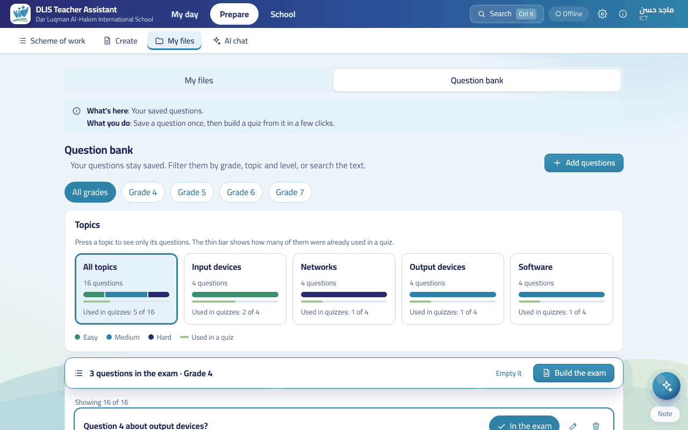 |

### Your classes
| | |
|---|---|
| **Classes and students**: your classes and their lists. Paste a list once. A lesson log, curriculum progress and class insights sit beside it. | 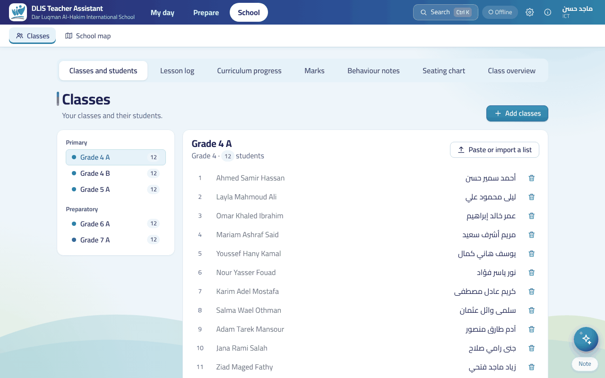 |
| **Weekly marks**: mark the week, fill full marks with one button (absent students stay empty) and upload to the LMS file. | 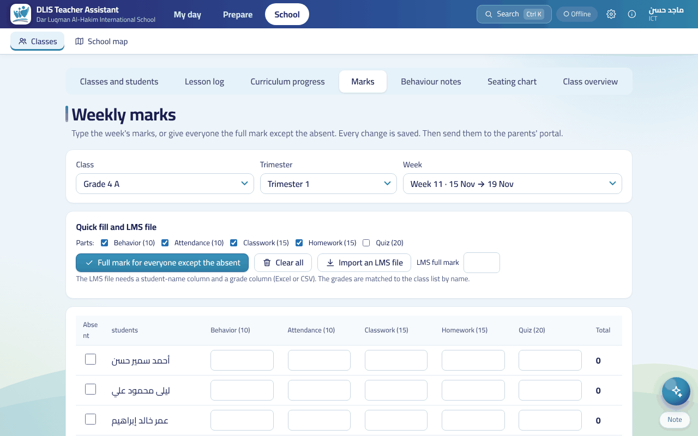 |
| **Behaviour notes**: note a good moment or a concern in seconds, and get a ready message for the parent. | 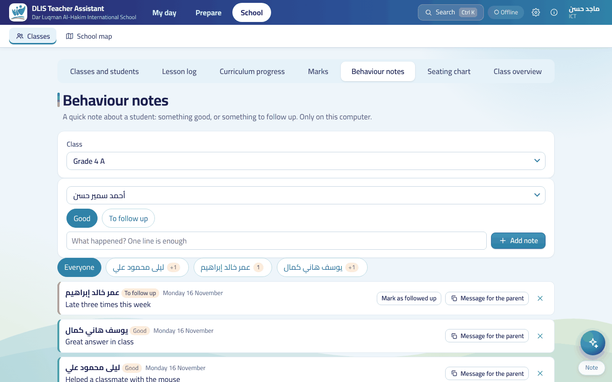 |
| **Seating chart**: drag students to seats, shuffle, or order by name, then print. | 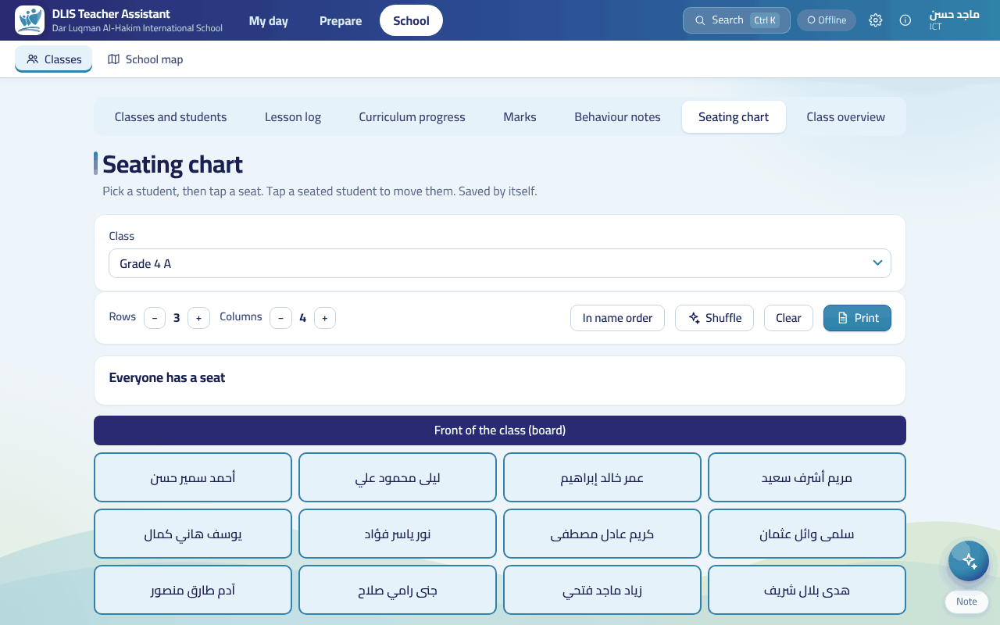 |
| **School map**: the building with its floors and rooms. Click a room to see what it is. | 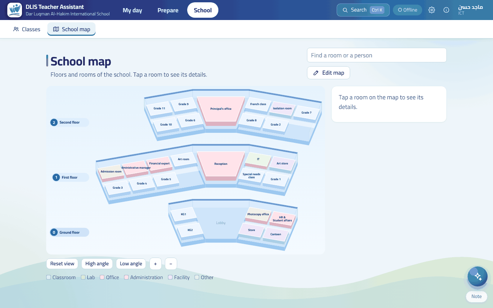 |
| **Settings**: language, text size, the lesson reminders, the AI connection and the school server. | 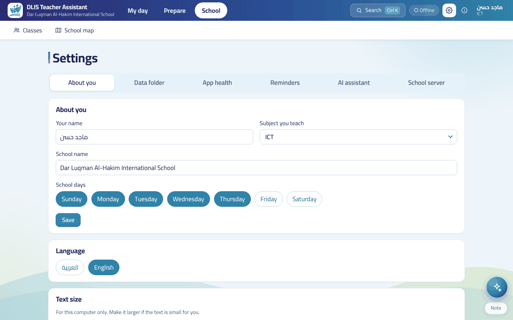 |

## Good to know
* **Student names never go to the AI.** Names are removed from every request before it leaves your computer, and put back only on your screen.
* **The AI stays inside your sources.** It answers from the books and files you gave it, not from guesses.
* **The program checks before it goes on.** When you press a button, it first checks the fields around it and tells you clearly what is missing or wrong.
* **Pluggable AI.** Many free services are listed, and you can add another one. The app explains how to get a key.
* **Parents' portal** (optional, needs the school's own free Supabase project): parents see only what you approve: grades, the week plan with homework and links, and quiz alerts. Never the lesson plan.
* **Updates from inside the app.** When a newer version is published, the app offers to download and install it, after checking the file.
* **Your data is yours.** It lives in a folder you pick. Each school has its own settings and its own private student lists; none of that is in this public code.

## Install
Download the installer from the **Releases** page: `DLIS_Teacher_Assistant_Setup.exe` for Windows, the `.dmg` for Mac. The app is not signed with a paid certificate, so Windows may warn: press *More info* then *Run anyway* (on Mac: right-click the app then *Open*, the first time). A guide is inside the app (*Help*).

## For developers
```
pip install -r requirements.txt
python run.py
python -m unittest discover -s tests
python scripts/e2e.py          # runs the whole app in a real browser
```
* The structure and how everything fits together: [`docs/DEVELOPER.md`](docs/DEVELOPER.md)
* The roadmap and what is done: [`docs/ROADMAP_AR.md`](docs/ROADMAP_AR.md)
* Building the installers and setting up a school (Arabic): [`docs/BUILD_AR.md`](docs/BUILD_AR.md)
* These pictures are made with invented data by `python scripts/make_readme_shots.py`.

The Arabic version of this page: [`README_AR.md`](README_AR.md)
