# مساعد المعلم DLIS

**مكان واحد هادي لأسبوع المدرس كله.** برنامج مكتبي (ويندوز وماك) لمدرسي مدرسة دار لقمان الحكيم الدولية: بيعرف جدولك وتقويم المدرسة، وبيجهّز ملفات Word الرسمية بضغطة واحدة، وبيرتّب ملفاتك وأسئلتك وملاحظاتك، وبيستخدم الذكاء الاصطناعي **من غير ما يبعتله اسم أي طالب أبدًا**.

عربي (من اليمين لليسار) وإنجليزي. وكل حاجة بتتحفظ في فولدر إنت اللي بتختاره على جهازك.

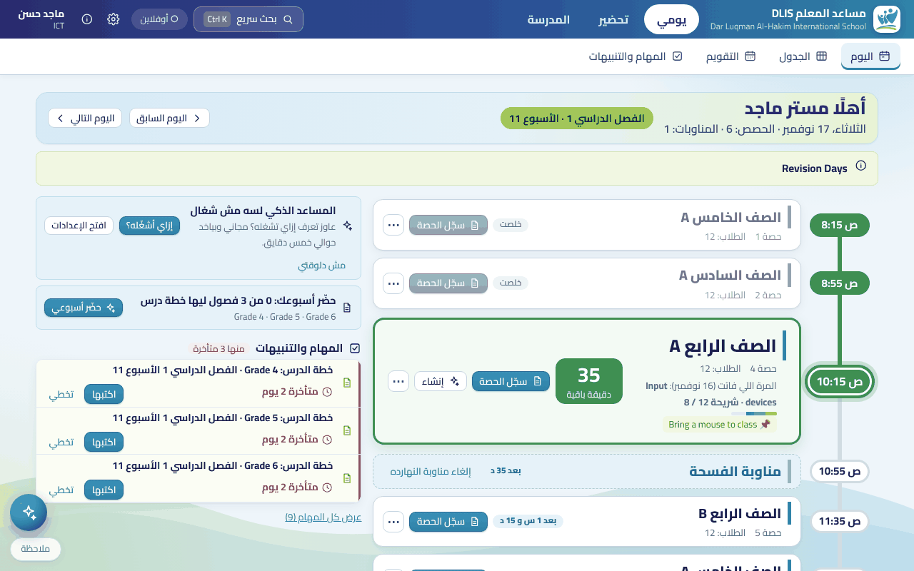

## البرنامج بيعمل إيه

### يومك
| | |
|---|---|
| **اليوم**: خط زمني لحصصك ومناوباتك. الحصة الحالية كبيرة والجاية صغيرة، وبيوريك الفصل وصل لفين وملاحظة آخر مرة، وبينبّهك قبل كل حصة بـ10 دقايق (ومش بينبّه لو الحصص ورا بعض). تقدر تغطي زميل، أو تبدّل حصتين، أو تلغي مناوبة ليوم واحد بس. |  |
| **الجدول**: جدولك الأسبوعي في شاشة واحدة من غير سكرول. مواعيد الحصص والفسحة والصلاة ونهاية اليوم هي هيكل المدرسة، وتقدر تعدّل «اليوم الدراسي». | 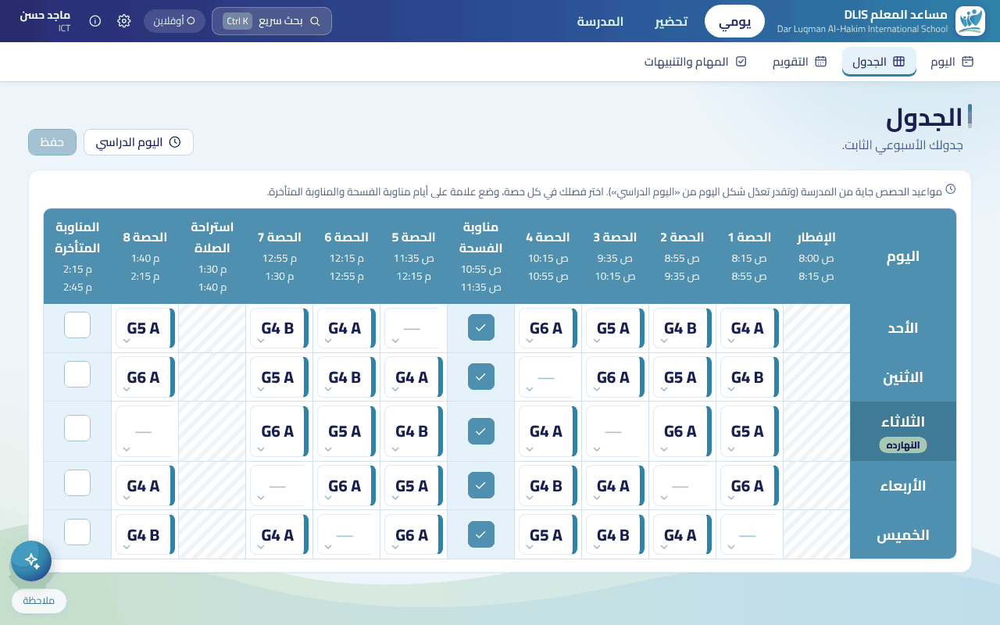 |
| **التقويم**: تقويم المدرسة الرسمي كصورة للسنة (شريط الأسابيع وعرض الشهر). الفصل الدراسي والأسبوع الحاليين متعلّمين دايمًا. | 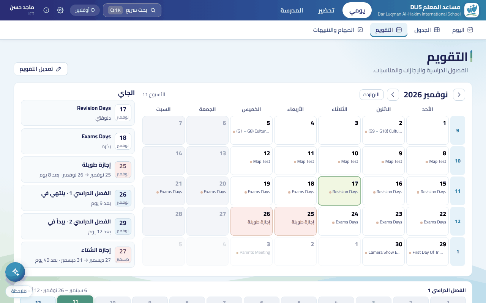 |
| **المهام والتنبيهات**: مهامك مع الأهمية والموعد، وخطط الدروس الناقصة بتتجمّع لوحدها. التنبيهات فيها تأجيل وتخطّي، وبتشتغل حتى بعد قفل الشباك. | 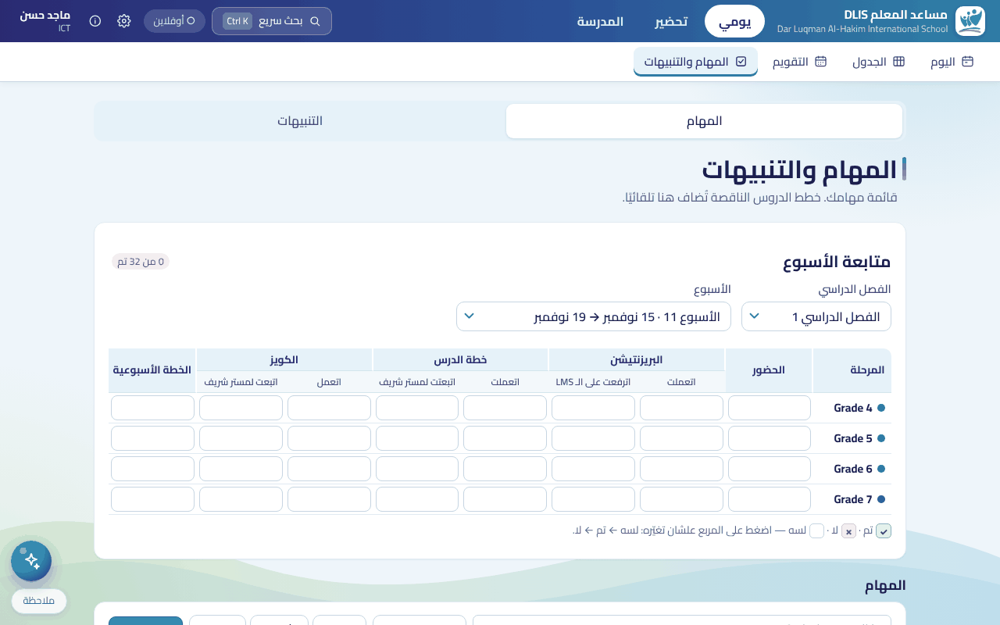 |

### التحضير
| | |
|---|---|
| **إنشاء**: صفحة واحدة لكل اللي بتعمله. ملفات DLIS الرسمية (خطة الدرس الأسبوعية، الكويز القصير، ملف المراجعة، كشف الدرجات، الشهادات وكروت الشكر، سلايدات الدرس) أيقونات كبيرة جنب 27 أداة ذكاء اصطناعي جاهزة. الفصل والترم والأسبوع بتختارهم جوه. | 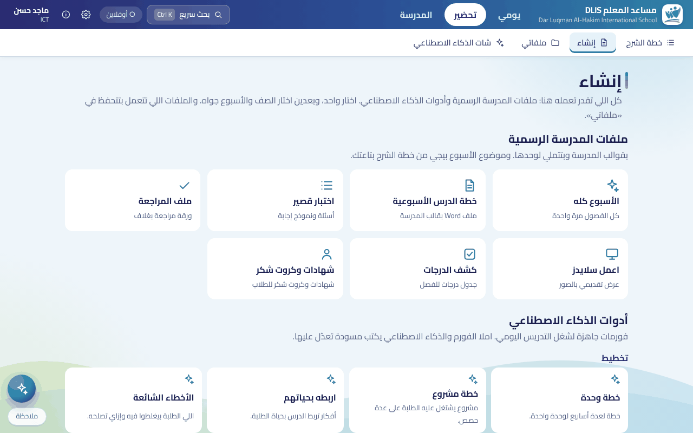 |
| **أدوات الذكاء الاصطناعي**: املا نموذج قصير (الموضوع والمستوى والعدد) واطلع بمسودة تعدّل عليها: خطط وحدات، rubrics، مهام متدرّجة، رسائل لأولياء الأمور وغيرها. الذكاء الاصطناعي بيقرا **مصادرك إنت** بس، ومش بيوصله أسماء الطلاب. | 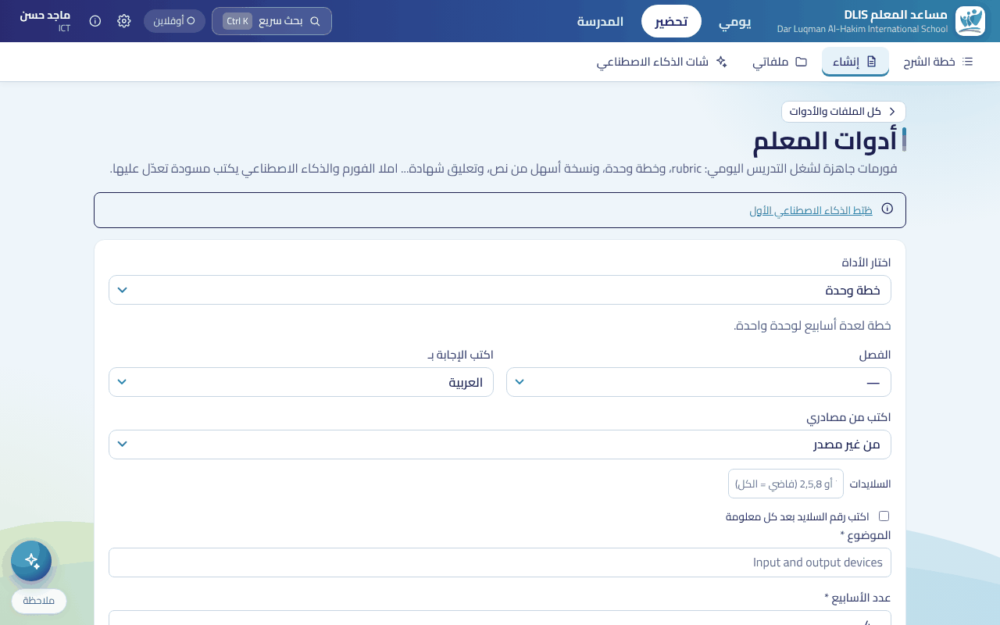 |
| **ملفاتي**: كل ملف ورابط ورسالة عملتها، مرتّبة بالصف والأسبوع. مفتاح واحد بيحدد إيه اللي يظهر للطلاب وأولياء الأمور. وكل ملف بتضيفه بيبقى متاح للذكاء الاصطناعي كمصدر. | 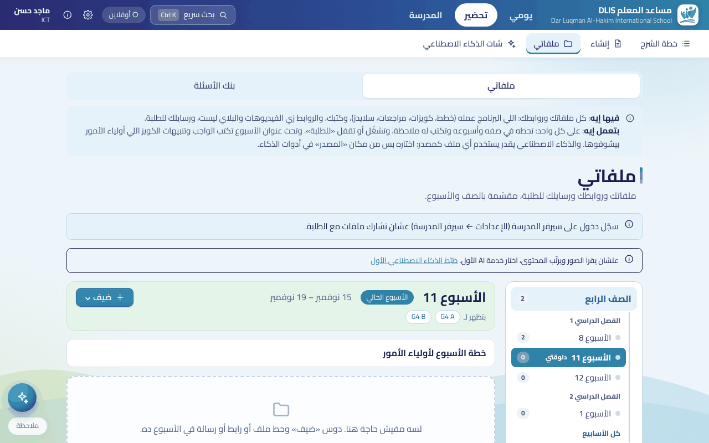 |
| **بنك الأسئلة وبناء الاختبارات**: كروت المواضيع بتوريك كام سؤال عندك وتوزيعها على المستويات وكام منها اتستخدم. ضيف أسئلة بالصق أو الكتابة أو من الذكاء الاصطناعي، واختار أسئلة من أي موضوع أو اختبار قديم، ورتّبها واعمل ملف اختبار واحد. | 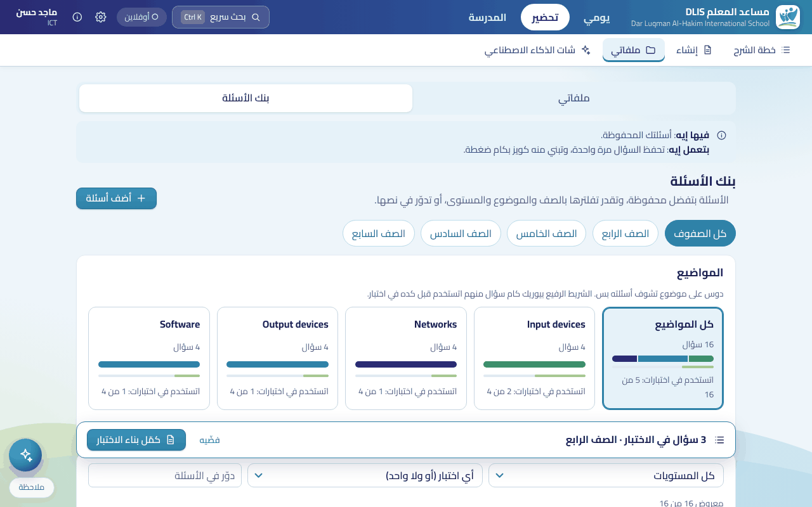 |

### فصولك
| | |
|---|---|
| **الفصول والطلاب**: فصولك وقوايمها. الصق القايمة مرة واحدة. وجنبها سجل الحصص وتقدّم المنهج ونظرة على الفصل. | 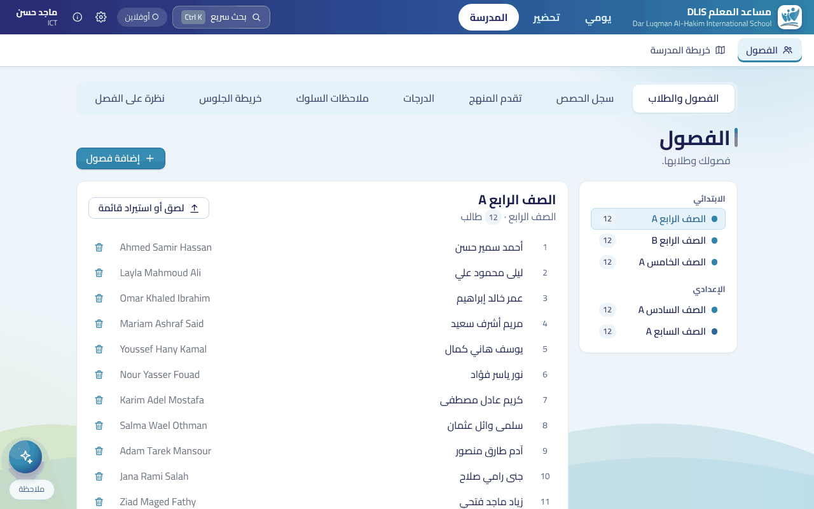 |
| **درجات الأسبوع**: اكتب درجات الأسبوع، واملا الدرجة الكاملة بزرار واحد (الغايبين بيفضلوا فاضيين)، وارفع ملف الـLMS. | 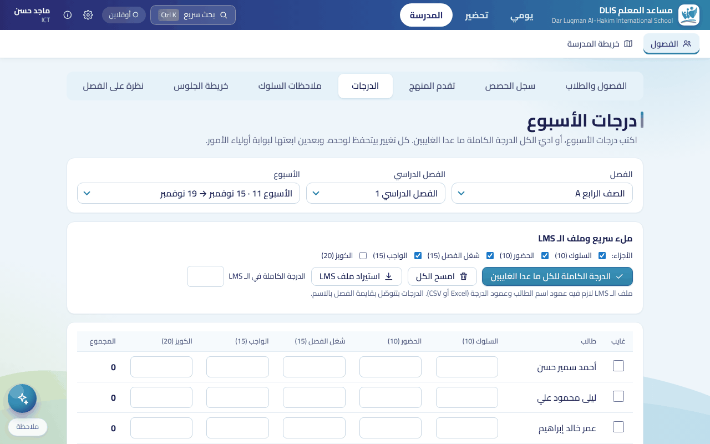 |
| **ملاحظات السلوك**: سجّل موقف حلو أو حاجة محتاجة متابعة في ثواني، وهتطلع لك رسالة جاهزة لولي الأمر. | 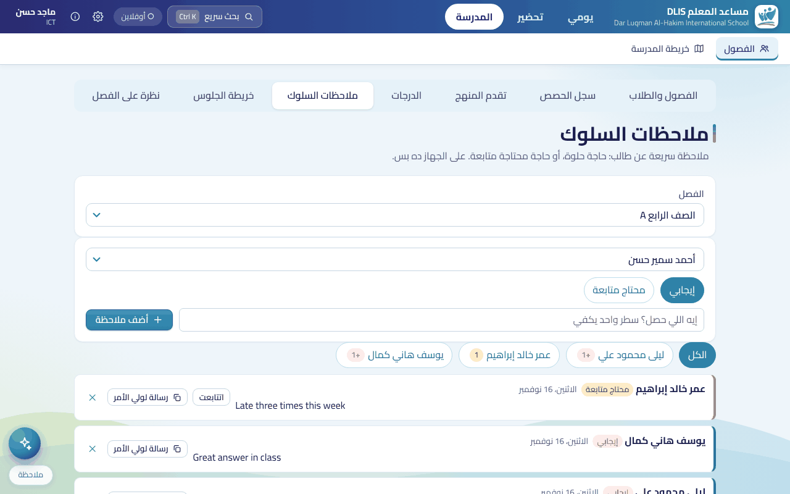 |
| **خريطة الجلوس**: رتّب الطلاب بالسحب، أو اخلط، أو رتّبهم بالأسماء، واطبع. | 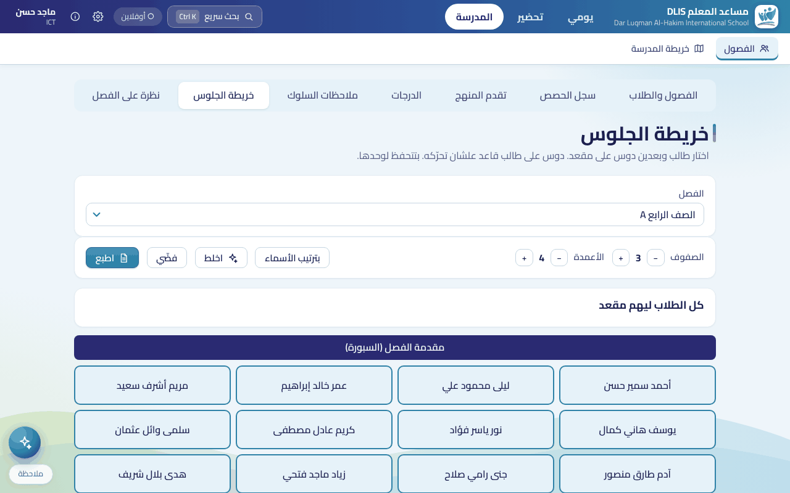 |
| **خريطة المدرسة**: المبنى بأدواره وغرفه. دوس على غرفة تشوف إيه هي. | 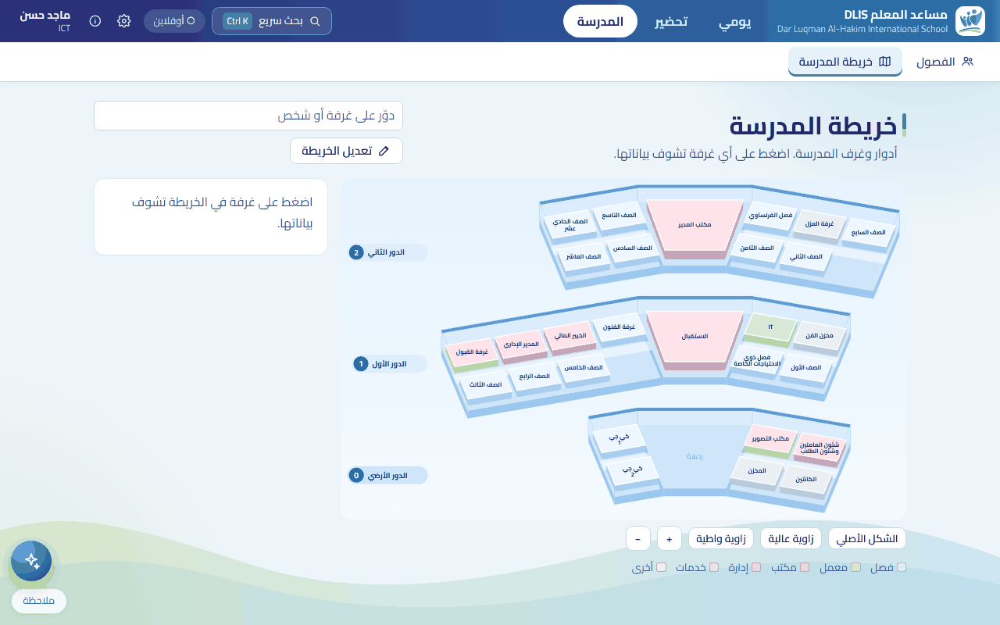 |
| **الإعدادات**: اللغة وحجم الخط وتنبيهات الحصص والذكاء الاصطناعي وسيرفر المدرسة. | 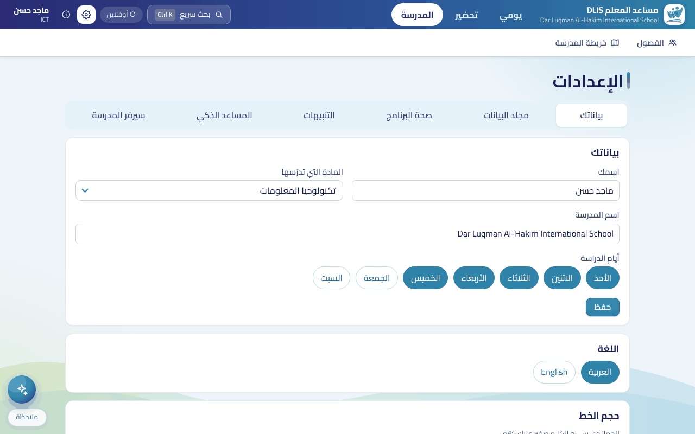 |

## حاجات مهمة تعرفها
* **أسماء الطلاب مبتروحش للذكاء الاصطناعي.** الأسماء بتتشال من أي طلب قبل ما يخرج من جهازك، وبترجع على شاشتك بس.
* **الذكاء الاصطناعي بيلتزم بمصادرك.** بيجاوب من الكتب والملفات اللي إنت إديتهاله، مش من دماغه.
* **البرنامج بيتأكد قبل ما يكمّل.** لما تدوس أي زرار، بيراجع الحقول اللي حواليه وبيقولك بوضوح إيه الناقص أو الغلط.
* **ذكاء اصطناعي قابل للتبديل.** فيه خدمات مجانية كتير، وتقدر تضيف خدمة جديدة، والبرنامج بيشرح إزاي تاخد المفتاح.
* **بوابة أولياء الأمور** (اختيارية، محتاجة مشروع Supabase مجاني للمدرسة): ولي الأمر بيشوف بس اللي إنت وافقت عليه: الدرجات وخطة الأسبوع بالواجب والروابط وتنبيهات الكويز. مش خطة الدرس أبدًا.
* **تحديث من جوه البرنامج.** لما تنزل نسخة أحدث، البرنامج بيعرض عليك تنزّلها وتثبّتها بعد ما يتأكد من الملف.
* **بياناتك بتاعتك.** في فولدر إنت بتختاره. وكل مدرسة ليها إعداداتها وقوايم طلابها السرّية، ومفيش حاجة منهم في الكود العام ده.

## التثبيت
نزّل ملف التثبيت من صفحة **Releases**: `DLIS_Teacher_Assistant_Setup.exe` للويندوز، وملف `.dmg` للماك. البرنامج مش موقّع بشهادة مدفوعة، فممكن ويندوز يحذّرك: دوس *More info* وبعدها *Run anyway* (وفي الماك: كليك يمين على البرنامج ← *Open* أول مرة). الدليل جوه البرنامج في تبويب **المساعدة**.

## للمطوّر
```
pip install -r requirements.txt
python run.py
python -m unittest discover -s tests
python scripts/e2e.py          # بيشغّل البرنامج كله في متصفح حقيقي
```
* شرح تركيب البرنامج: [`docs/DEVELOPER.md`](docs/DEVELOPER.md)
* خطة الطريق وإيه اللي اتعمل: [`docs/ROADMAP_AR.md`](docs/ROADMAP_AR.md)
* بناء ملفات التثبيت وتجهيز مدرسة جديدة: [`docs/BUILD_AR.md`](docs/BUILD_AR.md)
* الصور دي بتتعمل ببيانات وهمية بـ`python scripts/make_readme_shots.py`.

النسخة الإنجليزي من الصفحة دي: [`README.md`](README.md)
